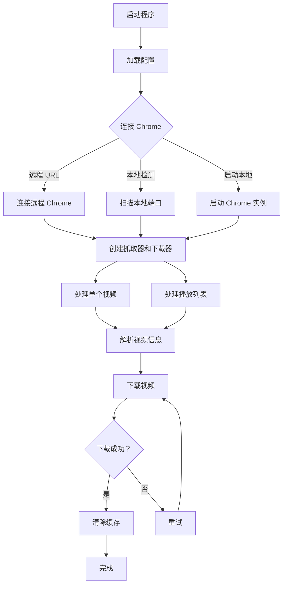

# Hanime Downloader

> ⚠️ **提示**：本项目由 AI 完全编写，**未经任何人工校对**。代码、文档及功能可能存在错误、缺陷或不完善之处，使用时请自行评估风险并谨慎测试。

Hanime 视频下载工具，使用 Chrome DevTools Protocol 进行网页抓取和下载。

## 🌐 语言选择

- 🇨🇳 [简体中文](#--简体中文)
- 🇬🇧 [English](#-english)

---

## 📦 最新版本：v0.4.7 (2026-10-19)

## 🛠️ v0.4.7 审计整改 (2026-10-19)

针对一次完整的代码审计做了一批修复与工程基线建设。本版本包含以下**破坏性变更**，升级前请留意：

- ⚠️ **移除配置项 `DirectDownloadFirst`** - 该字段此前贯穿 `Config`、`web.Options`、`Downloader`
  全链路却从未被读取，现已删除；旧 `config.yaml` 中若仍保留该键会被静默忽略（`yaml.v3` 不报未知键）
- ⚠️ **`config.yaml` 不再随仓库分发** - 改为通用占位的 `config.example.yaml`，本机配置已被
  `.gitignore` 忽略；首次运行会自动生成，或手动 `cp config.example.yaml config.yaml`

各项改动分布在 `downloader/`、`scraper/`、`web/`、`chrome/`、`main.go` 与仓库根目录。

- 🔒 **下载落盘完整性** - 下载字节数与 `Content-Length` 不一致时不再把残缺临时文件改名为成品，
  并区分「总长未知」与「0 字节」的进度语义
- ⏱️ **超时与取消** - 去掉实际等于无超时的超长 `Timeout`，改为分段超时（连接 / TLS / 响应头）＋
  「字节长时间无增长」的空闲读超时
- 🧵 **并发安全** - 同一路径的并发下载串行化，避免并发写同一临时文件导致文件损坏
- 🐛 **错误分类** - 按类型化状态码（410 / 416）分支，不再用 `strings.Contains(err.Error(), "410")` 猜状态码
- 🖼️ **封面与抓取** - 高清封面搜索不再硬编码单一分类；抽取下载页解析与分辨率选择的重复实现，
  失败时明确回落并打 WARN
- 🧹 **配置卫生** - `config.yaml` 示例化为 `config.example.yaml`，本机私有配置改为 gitignore；
  移除从未被读取的无效配置项 `DirectDownloadFirst`
- 🧪 **测试** - 为 `downloader/`、`scraper/`、`web/`、`main` 补齐**离线**单元测试
  （`httptest` / 纯函数，不依赖 Chrome 与外网），测试代码约 3000 行
- 🧰 **工程基线** - 新增 `Makefile`（`build` / `vet` / `fmt` / `fmt-check` / `lint` / `test` / `all`）
  与 `.golangci.yml`（golangci-lint v2.14.0），并记录只读 `GOCACHE` 这一环境陷阱
- 🛑 **生命周期** - 接入 `signal.NotifyContext` 与优雅停机；修复本地 Chrome 实例与临时 profile
  目录不回收的进程泄漏；Web API 错误统一为 `{"error","message"}` JSON 契约

### 历史版本：v0.4.6 (2026-07-19)

#### 主要特性
- ✨ **Web 管理界面** - 提供可视化的视频下载管理界面
- 🎨 **现代化 UI** - 基于 HTML/CSS/JavaScript 的响应式设计
- 📊 **实时进度显示** - 可视化显示下载进度和状态
- 🔄 **批量操作** - 支持通过 Web 界面批量管理下载任务

#### 更新内容
- 重构项目结构，采用模块化设计
- 新增 `web/` 模块提供 Web 服务器功能
- 新增 `chrome/` 模块独立 Chrome 浏览器管理
- 新增 `scraper/` 模块独立网页抓取逻辑
- 新增 `downloader/` 模块独立文件下载逻辑
- 新增 `config/` 模块独立配置管理

#### 修复
- 🐛 **目录自动创建** - 修复下载时目标父目录（如 `download/<影片名>/`）不存在导致临时文件创建失败的问题，现会在写入前自动 `MkdirAll` 父目录
- 🐛 **新标签页代替新窗口** - 修复 chromedp 在远程浏览器下每次抓取都会打开「新窗口」的问题，改为在已有浏览器中打开「新标签页」（新增 `chrome.CreateTab()`，`scraper` 通过 `WithTargetID` 附着，任务结束自动关闭标签页）

## 功能特性

- 🎬 支持单个视频下载
- 📋 支持播放列表批量下载
- 🔄 支持断点续传
- 📦 支持下载进度缓存
- 🌐 支持代理配置
- 🎨 支持多分辨率选择
- ⚡ 支持多线程并发下载

## 项目结构

```
hanime-dl/
├── main.go                        # 主程序入口
├── main_test.go                   # 主流程 / 进度聚合测试（离线）
├── config/
│   └── config.go                  # 配置管理模块
├── chrome/
│   └── chrome.go                  # Chrome 浏览器管理模块
├── scraper/
│   ├── scraper.go                 # 网页抓取模块
│   └── scraper_test.go            # 抓取模块纯函数测试（离线）
├── downloader/
│   ├── downloader.go              # 文件下载模块
│   └── downloader_test.go         # 下载模块测试（离线，httptest）
├── web/
│   ├── index.html                 # 内置 Web 界面（打包进二进制）
│   ├── web_server.go              # Web 服务器模块
│   └── web_server_test.go         # Web handler / 下载管线测试（离线）
├── config.example.yaml            # 配置示例（提交进仓库）
├── config.yaml                    # 本机实际配置（首次运行自动生成，已被 .gitignore 忽略）
├── Makefile                       # 构建 / 检查 / 测试入口
├── .golangci.yml                  # golangci-lint 配置（v2 schema）
├── go.mod                         # Go 模块定义
├── go.sum                         # 依赖校验和
└── README.md                      # 项目说明
```

> `config.yaml` **不随仓库分发**：它属于本机私有配置（可能含内网地址与代理），已被 `.gitignore` 忽略。
> 首次运行且该文件不存在时程序会自动生成一份默认配置；需要手写时请从 `config.example.yaml` 复制。

### 模块说明

| 模块 | 功能 | 主要函数 |
|------|------|----------|
| `config` | 配置管理 | `LoadOrCreate()`, `MustLoadOrCreate()` |
| `chrome` | Chrome 浏览器管理 | `GetWebSocketDebuggerURL()`, `AutoDetectChrome()`, `StartLocalChrome()`, `CreateTab()` |
| `scraper` | 网页抓取 | `GetPlaylist()`, `ResolveVideoInfo()`, `RefreshVideoDataURL()` |
| `downloader` | 文件下载 | `DownloadFile()`, `DownloadWithRetry()` |
| `web` | Web 服务器 | `RunWebServer()`, `NewWebServer()` |

## 安装

### 前置要求

- Go 1.24+（`go.mod` 声明的版本）
- Google Chrome 或 Chromium 浏览器

### 编译

```bash
# 克隆项目
git clone <repository-url>
cd hanime-dl

# 下载依赖
go mod download

# 编译
go build -o hanime-dl .
```

也可以直接用 Makefile：

```bash
make build      # go build ./...
make test       # go test -race ./...
make lint       # golangci-lint run ./...
make fmt-check  # 检查 gofmt 是否干净
make all        # fmt-check + vet + build + test + lint
```

## ⚠️ 环境陷阱：Go 构建缓存只读（GOCACHE）

某些环境（例如本机的 `/root/.cache/go-build`）下，默认 Go 构建缓存目录是**只读**的。
此时任何 `go build` / `go vet` / `go test` 都会以如下形式失败，看起来像是代码问题，
实际只是缓存不可写：

```
go: creating work dir: mkdir /root/.cache/go-build/...: read-only file system
```

解决办法是把 `GOCACHE` 重定向到可写目录（`.dbg/` 已加入 `.gitignore`）：

```bash
export GOCACHE=$PWD/.dbg/gocache
export GOPATH=$PWD/.dbg/gopath          # 可选；依赖已就位时非必需
export GOLANGCI_LINT_CACHE=$PWD/.dbg/golangci-cache   # 仅 golangci-lint 需要
```

上面的 `Makefile` 已经用 `?=` 为 `GOCACHE` / `GOLANGCI_LINT_CACHE` 设好了仓库内默认值，
所以 `make build` / `make test` / `make lint` 无需先手工 export 即可运行；
若你已导出同名变量，则以你的值为准。

其他说明：

- `make fmt` / `make fmt-check` 只处理 **git 认得的** `.go` 文件，
  不会递归进入 `.dbg/`（那里有上万个第三方源码文件）。**请勿手写 `gofmt -w .`。**
- 本机依赖模块已下载在 `.dbg/gopath/pkg/mod`，正常构建**不需要联网**，也不需要设置 `GOPROXY` / `http_proxy`。

## 配置

配置文件的优先级（默认路径 `config.yaml`，可用 `-config` 指定）：

1. 已存在 `config.yaml` → 直接读取；
2. 不存在 → 程序自动写入一份等价于 `config.example.yaml` 正文的默认配置后再读取。

手写配置时请从示例复制，**不要**在 `config.example.yaml` 里写任何内网 / 私有地址：

```bash
cp config.example.yaml config.yaml
```

```yaml
# Chrome 远程调试 URL
chromeRemoteURL: http://localhost:9222/json/version

# 缓存目录
CacheDir: ./cache

# 下载目录
DownDir: ./downloads

# HTTP 代理（可选，留空表示直连）
HttpProxy: http://proxy.example.com:8080

# 最大并发下载线程数
MaxDownloadWorkers: 3

# 播放列表 ID 列表（字符串数组，可留空；写法：- "playlist-id-1"）
ListCode: []

# 单个视频 ID 列表（字符串数组，可留空；写法：- "video-id-1"）
SingleCode: []

# 下载后清除缓存
ClearCache: true

# 视频分辨率（如：1080p, 720p；未配置或未命中时回落最高分辨率）
VideoResolution: 1080p
```

### 配置项说明

| 配置项 | 类型 | 默认值 | 说明 |
|--------|------|--------|------|
| `chromeRemoteURL` | string | `http://localhost:9222/json/version` | Chrome DevTools 调试地址 |
| `CacheDir` | string | `./cache` | 缓存目录路径 |
| `DownDir` | string | `./downloads` | 视频下载目录路径 |
| `HttpProxy` | string | `http://proxy.example.com:8080` | HTTP 代理地址（留空＝直连） |
| `MaxDownloadWorkers` | int | `3` | 并发下载线程数 |
| `ListCode` | []string | `[]` | 播放列表 ID 列表 |
| `SingleCode` | []string | `[]` | 单个视频 ID 列表 |
| `ClearCache` | bool | `true` | 单个视频下载成功后是否删除其 `cache/info_<id>.json`（列表缓存另按列表进度清理） |
| `VideoResolution` | string | `1080p` | 目标分辨率；未配置或未命中时回落最高分辨率 |

> **关于默认值与字段名大小写**
>
> - 默认值集中定义在 `config/config.go` 的常量中（`DefaultDownDir` 等），模板与常量不会漂移。
> - **下载目录默认值是 `./downloads`**。历史版本中 `web` 包的内置兜底值曾写作 `./download`，
>   二者不一致；现已以 `config/config.go` 的常量为唯一权威值，其他位置应引用它。
> - YAML 键名**区分大小写**（`yaml.v3` 在显式 tag 下按精确串匹配），且**写错大小写不会报错，只会被静默忽略**
>   （字段留空/零值）。请严格照抄上表中的写法，尤其是 `chromeRemoteURL`（首字母小写）。

## 使用方法

### 运行程序

```bash
# 使用默认配置
./hanime-dl

# 指定配置文件
./hanime-dl -config /path/to/config.yaml

# 查看帮助
./hanime-dl -h
```

### 命令行参数

| 参数 | 默认值 | 说明 |
|------|--------|------|
| `-config` | `config.yaml` | 配置文件路径 |
| `-web` | `false` | 启动 Web 服务器模式 |
| `-web-addr` | `:8080` | Web 服务器地址 |

### Web 界面使用 （推荐）

启动 Web 服务器模式：
直接如无配置CDP 或 连接失败 ,默认会启动本地 Chrome 实例,并连接到该实例

```bash
# 使用默认配置启动 Web 服务器
./hanime-dl -web

# 指定端口
./hanime-dl -web -web-addr :3000

# 访问 Web 界面
# 打开浏览器访问 http://localhost:8080
```

Web 界面功能：
- 📱 响应式设计，支持移动端访问
- 📋 查看下载队列和进度
- ⚙️ 配置下载参数
- 🎬 管理视频下载任务
- 📊 实时显示下载状态


### Chrome 浏览器设置

#### 方式 1：手动启动 Chrome（推荐）

```bash
# Linux
google-chrome --remote-debugging-port=9222

# macOS
"/Applications/Google Chrome.app/Contents/MacOS/Google Chrome" --remote-debugging-port=9222

# Windows
"C:\Program Files\Google\Chrome\Application\chrome.exe" --remote-debugging-port=9222
```

#### 方式 2：使用 Docker 桌面环境

```bash
cd ubuntu-desktop
docker compose up -d
```

#### 方式 3：配置远程 Chrome

在 `config.yaml` 中设置远程 Chrome 地址：

```yaml
chromeRemoteURL: http://your-chrome-host:9222/json/version
```


## 工作流程



## 缓存机制

程序使用缓存来提高效率和支持断点续传：

- **播放列表缓存**: `cache/list_<video-id>.json`
- **视频信息缓存**: `cache/info_<video-id>.json`

缓存文件包含：
- 播放列表：视频 ID 列表
- 视频信息：标题、封面图 URL、下载 URL、文件路径等

设置 `ClearCache: true` 可在下载完成后自动清除缓存。

## 错误处理

程序包含完善的错误处理机制：

- **自动重试**: 下载失败时自动重试最多 5 次
- **完整性校验**: 下载字节数与 `Content-Length` 不一致时保留 `.tmp` 临时文件，**绝不改名成残缺成品**
- **类型化错误分类**: 410 / 416 等状态码按 `errors.As` 分支处理，不再做错误字符串匹配
- **重复提交保护**: 同一视频重复提交返回 `409`，同一路径的并发下载串行化
- **优雅停机**: 收到 `SIGINT` / `SIGTERM` 后停止接收新任务，有界等待在途任务后退出
- **统一 JSON 错误契约**: Web API 错误统一返回 `{"error","message"}`，前端可直接 `response.json()`
- **断点续传**: 支持从上次中断的位置继续下载
- **代理支持**: 支持 HTTP 代理，适用于网络受限环境
- **分辨率降级**: 请求的分辨率不可用时自动降级到可用分辨率

## 常见问题

### Q: 无法连接到 Chrome

**A**: 确保 Chrome 已启动并启用远程调试：
```bash
google-chrome --remote-debugging-port=9222
```

### Q: 下载速度慢

**A**: 
1. 检查代理配置是否正确（`HttpProxy`，留空表示直连）
2. 适当增加 `MaxDownloadWorkers` 值（注意不要把带宽和服务端限流打满）
3. 若目标分辨率较高，可尝试把 `VideoResolution` 调低（如 `720p`）

### Q: 视频分辨率不符合要求

**A**: 设置 `VideoResolution` 为所需分辨率，如 `1080p`、`720p` 等。

### Q: 如何继续中断的下载

**A**: 程序会自动检测缓存并继续未完成的下载。只需重新运行程序即可。

## 开发指南

### 添加新功能

1. 在对应模块中实现功能
2. 在 `main.go` 中调用新函数
3. 更新 `README.md` 文档

### 代码规范

- 格式化：`make fmt`（等价于 `gofmt -l -w`，仅作用于 git 跟踪/新增的 `.go` 文件）
- 格式检查：`make fmt-check`
- 静态检查：`make vet`（`go vet ./...`）
- Lint：`make lint`（`golangci-lint run ./...`，配置见 `.golangci.yml`，基于 golangci-lint **v2.14.0** 的 v2 schema）
- 测试：`make test`（`go test -race ./...`）
- 一次跑完：`make all`（`fmt-check` + `vet` + `build` + `test` + `lint`）

写测试时请保持**离线**：不得依赖 Chrome、不得访问外网。
现有 `downloader/downloader_test.go`（`httptest.Server`）与 `scraper/scraper_test.go`（纯函数）可作参考。

> 提示：若 `make lint` 报找不到 golangci-lint，可设置
> `export PATH=$PWD/.dbg/gopath/bin:$PATH`（Makefile 默认也会尝试该路径）。

## 许可证

MIT License

## 贡献

欢迎提交 Issue 和 Pull Request！

## 致谢

- [chromedp](https://github.com/chromedp/chromedp) - Chrome DevTools Protocol 库
- [gopkg.in/yaml.v3](https://gopkg.in/yaml.v3) - YAML 解析库

---

## 🇬🇧 English

### Latest Version: v0.4.7 (2026-10-19)

#### What's New
- 🛡️ **Download integrity** - byte-count validation against `Content-Length`; a truncated `.tmp` is never renamed to the final file
- 🧪 **Offline test suite** - ~3,000 lines of `httptest` / pure-function tests, plus a `Makefile` and `golangci-lint` baseline
- ⚠️ **Breaking changes** - `DirectDownloadFirst` removed (it was plumbed through the stack but never read); `config.yaml` is now machine-local and gitignored, ship `config.example.yaml` instead
- ✨ **Web Management Interface** - Visual video download management
- 🎨 **Modular Refactoring** - Clean project structure (chrome/, config/, scraper/, downloader/, web/)
- 📊 **Real-time Progress** - Visual download status
- 🔄 **Batch Operations** - Manage download tasks via Web interface

#### Features
- 🎬 Single video download support
- 📋 Playlist batch download support
- 🔄 Resume interrupted downloads
- 📦 Download progress caching
- 🌐 Proxy configuration support
- 🎨 Multiple resolution options
- ⚡ Multi-threaded concurrent downloads

#### Quick Start

**Prerequisites**
- Go 1.24+ (as declared in `go.mod`)
- Google Chrome or Chromium browser

**Build**
```bash
# Clone the repository
git clone <repository-url>
cd hanime-dl

# Download dependencies
go mod download

# Build
go build -o hanime-dl .
```

Or just use the Makefile: `make build`, `make test`, `make lint`, `make all`.

> **Environment gotcha — read-only Go build cache.** On hosts where the default
> `GOCACHE` (`/root/.cache/go-build`) is read-only, every `go build` / `go vet` / `go test`
> fails with `read-only file system`. Redirect it before running anything:
> ```bash
> export GOCACHE=$PWD/.dbg/gocache
> export GOLANGCI_LINT_CACHE=$PWD/.dbg/golangci-cache
> ```
> The `Makefile` already defaults both to `.dbg/` (gitignored), so `make ...` works as-is.

**Configuration**
`config.yaml` is **not** shipped in the repository — it is machine-local (it may contain
private addresses) and is gitignored. Copy the example, or let the program generate a
default one on first run:
```bash
cp config.example.yaml config.yaml
```
```yaml
chromeRemoteURL: http://localhost:9222/json/version
CacheDir: ./cache
DownDir: ./downloads
HttpProxy: http://proxy.example.com:8080
MaxDownloadWorkers: 3
ListCode: []
SingleCode: []
ClearCache: true
VideoResolution: 1080p
```
YAML keys are **case-sensitive** and a misspelled key is silently ignored (the field just
stays empty), so copy the spellings exactly — especially `chromeRemoteURL`.

**Chrome Setup**
```bash
# Linux
google-chrome --remote-debugging-port=9222

# macOS
"/Applications/Google Chrome.app/Contents/MacOS/Google Chrome" --remote-debugging-port=9222

# Windows
"C:\Program Files\Google\Chrome\Application\chrome.exe" --remote-debugging-port=9222
```

**Run**
```bash
# Default configuration
./hanime-dl

# Web server mode
./hanime-dl -web -web-addr :8080

# View help
./hanime-dl -h
```

**Web Interface**
Access `http://localhost:8080` for:
- 📱 Responsive design (mobile-friendly)
- 📋 View download queue and progress
- ⚙️ Configure download parameters
- 🎬 Manage video download tasks
- 📊 Real-time download status

#### Releases
- **v0.4.7** (2026-10-19): Code-audit remediation — download integrity (byte-count validation, 206
  `Content-Range` start verification), segmented/idle timeouts, per-path download mutex, typed HTTP
  error classification, scraper de-duplication + WARN fallbacks, graceful shutdown, offline unit tests,
  `Makefile` + `.golangci.yml` baseline, `config.yaml` → `config.example.yaml` (machine-local config is
  now gitignored), removal of the never-read `DirectDownloadFirst` setting
- **v0.4.6**: Bug fixes - auto-create download dirs, open new tab instead of new window (`CreateTab`)
- **v0.4.1**: Modular refactoring, Web interface added
- **v0.4.0**: Initial modular architecture
- **v0.3.1**: Bug fixes and improvements

Download binaries from [GitHub Releases](https://github.com/mingjiezxc/hanime-dl/releases)

#### License
MIT License

#### Contributing
Issues and Pull Requests are welcome!

#### Acknowledgments
- [chromedp](https://github.com/chromedp/chromedp) - Chrome DevTools Protocol library
- [gopkg.in/yaml.v3](https://gopkg.in/yaml.v3) - YAML parsing library
